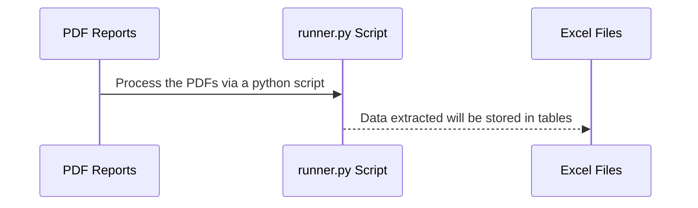
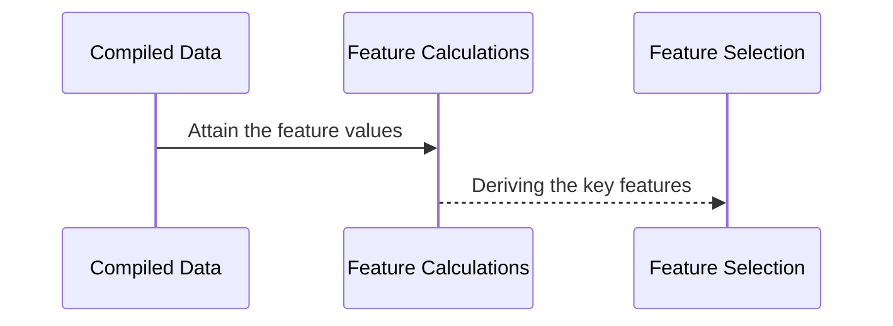

# BT4103 Capstone Project

### Development and Implementation of Credit Risk Features

#### Introduction

Banks offer financing options to customers which can take the form of credit loans . However, the inability to quantify applicant's risk of default may become a liability for the bank, as defaulting on loan obligations would mean the incurrence of financial losses. To mitigate this, it is imperative that banks employ suitable risk-mitigation measures in order to quantify applicant's credit risk and lend in accordance to the permissible risk tolerance level.

This project aims to develop a model capable of identifying credit risk features with high explanatory power to account for risk of default from prospective loan borrowers. This document provides a high-level overview of the process from start to end, along with steps on running the necessary files and machine learning models in this repository.

<br />

#### Installation Guide

Certain segments of this project uses specific package versions. Any deviation of those versions listed in the _requirements.txt_ file may lead to errors while running the scripts. To install the correct packages and their respective versions, follow the steps listed below:

1. Open a command prompt / terminal, and cd into the folder

   `$ cd Capstone-Project`

2. Run the installer script located in the root directory of the folder

   `$ python3 installation-script.py`

> **Note** Version 7 of pdfplumber has been proven to cause some errors when running the data extraction scripts. Be sure to follow the exact version in _requirements.txt_ file.

<br />

#### Runnin the data pipeline

For a collective execution of data extraction, random data generation, data compilation, feature generation and feature calculation processes, execute the _runner.sh_ file in a terminal or command prompt. To achieve this, perform the following steps:

1. cd into the root directory which contains the _runner.sh_ file
2. Type the following command to make it executable

   `$ chmod +x runner.sh`

3. Run the script with the following command

   `$ ./runner.sh`

If successful, the script should execute all commands and output the complete pipeline in the terminal.

<br />

#### Data Extraction



To initiate the data extraction process, follow the steps below:

1.  Place the pdf files into the respective eins/ibs folders located inside the main **Dataset** root folder
2.  cd into the directory containing the runner script, denoted as _runner.py_
3.  Run the following command in terminal or command prompt

    `$ python3 runner.py`

> **Note** Replace the _runner.py_ with the actual _.py_ file name in the folder

4.  The output will be stored in the respective output folders

<br />

#### Data Transformation

This optional phase in the data pipeline involves manipulating the respective tables in EINS and IBS reports to conform with the definition laid out in the Entity-Relationship diagram


Although the subsequent phases of our project did not require an extensive adherence to a specific schema for the table relations, we believe that the ER diagram provides users with an accurate depiction of the relationships across all tables in the reports. This can be useful in future applications when there is a need to store the generated information in a data warehouse or database.

<br />

#### Litigation Clustering

This phase in the data pipeline involves transforming unstructured text data regarding litigation into categorical data suitable for feature modelling.

The code for clustering the text data can be found in the _litigation clustering_ script, where the text data will be converted to text embeddings using a pretrained **BERT** language model and assigned a cluster out of the clusters which were derived from sample data.

<br />

#### SSIC Mapping

This phase in the data pipeline involves mapping the principal activities of a business into 5 categories: **Section**, **Division**, **Group**, **Class**, and **Sub-Class**.

The data of the mappings are manually retrieved from this [website](https://www.singstat.gov.sg/standards/standards-and-classifications/ssic)

The code for clustering the text data can be found in the _ssic mapping_ script, where the **5** digit principal activities code will be matched against the code of all present and past versions of SSIC and mapped to the latest categories possible.

<br />

#### Random Data Generation

This stage of the data pipeline involves executing a new runner script that churns out additional data so as to supplement the existing pool of raw data at our disposal. Dependencies include a _...variables.json_ file that stores all the potential attributes that can be used in randomising certain fields within the report, as well as the attribute fields in **litigation_data** folder.

Contents of a _variables.json_ file:

```
{
    "firstName": [
        "SUNSHINE", "SUNSET", "MOONLIGHT"...
    ],
    "middleName": [
        "PLASTIC", "GREENYARN"...
    ],
    "sector": [
        "INTERNATIONAL", "REGIONAL"...
    ],
    ...
}
```

The randomisation process occurs in the main _random generation_ runner script, where each randomised field is bounded to a range of values.

The following schematic flow shows the entire randomisation process:


To perform a sample random generation of data for EINs and IBS, follow the steps below:

1. cd into the directory containing the runner script.
2. Tweak the value for 'numberOfRandomData' to change the number of random data to be generated. This section of the code can be found at the bottom of the script.

   ```
   if __name__ == "__main__":
       numberOfRandomData = 1000
       for i in tqdm(range(numberOfRandomData)):
           main()
       print(f'====> {numberOfRandomData} random generation(s) executed successfully!')
   ```

3. Run the following in command prompt

   `$ python3 random_combined_generation.py`

The output will be stored in the respective output folders for EINS or IBS.

<br />

#### Feature Generation

The current feature pool only contains slightly over a hundred features, which are namely the columns found in the tables across both reports. However, to increase the current feature pool size, we employed general intuition and research to create new interaction variables from the existing features.

For instance:

- $feature_C$ can be created from multiplying $feature_A$ and $feature_A$ together
- $feature_D$ can be created from dividing $feature_A$ and $feature_B$ together

For each categorical feature, the resultant feature generated count would simply be the multiplication of the respective feature count for the constituent features. Relating to the above example, if $feature_A$ and $feature_B$ have $10$ and $20$ features respectively, $feature_C$ and $feature_D$ would both have $10 * 20 = 200$ features in total.

In total, our script was able to generate over $8700$ features from the initial count.

<br />

#### Feature Selection, Calculation and Information Value (IV)

**Information Value** (IV) is one of the key statistical metrics employed in identifying the features with high explanatory power for predicting an individual's credit worthiness. From a basket of features, IV can be used to reduce the dimensionality of a model and and isolate the most relevant features that ultimately contributes to an accurate predictive model, all while avoiding the issue of overfitting.

The formula for Information Value (IV) can be shown below:

$$IV = \sum_{} (Event Percentage - NonEvent Percentage) * (WOE)$$

Another statistical measure used in feature selection is Weight of Evidence (WoE). It computes the robustness of the relationship between a categorical predictor variable and binary target variable.

The formula for WoE of a category can be shown below:

$$WOE = ln(\frac{Event Percentage}{NonEvent Percentage})$$

Once the data from all reports has been compiled and transformed into the respective tables that adhere to the structural relationships denoted in the entity-relationship diagram, the process of feature selection and calculation will take place.



<br />

#### Feature Modelling

The final phase of this project involves developing a series of machine learning models to train our dataset on. Since the target variable is binary (i.e yes/no), we have identified the following machine learning models that would be useful in credit risk prediction.

1. Logistic Regression
2. Decision Tree Classifier
3. Naive Bayes Classifier
4. K-Nearest Neighbours Classifier
5. Support Vector Machine Classifier
6. Random Forest Classifier
7. Extreme Gradient Boosting (XBG) Classifier
8. Light Gradient Boosting Machine (LightGBM) Classifier

For Mac: When faced with an OSError, run the following command to resolve it:

`$ brew install libomp`

#### Model Evaluation via Static Dashboard

We chosen five evaluation metrics - **accuracy**, **precision**, **recall**, **ROC AUC**, and **KS Stat** - to assess the performance of our classifiers. We selected these metrics for their particular advantages in evaluating a classifier's performance. The overall performances of the models used for the machine learning phase can be summarised in the diagram below.


- Accuracy: Proportion of correct predictions over the total number of predictions
- Precision: Proportion of true positives over the total number of positive predictions
- Recall: Proportion of true positives over the total number of actual positive samples
- ROC AUC: Graphical representation of the trade-off between true positive rate (sensitivity) and false positive rate (1-specificity) as the classification threshold is varied
- KS Stat: Maximum difference between the cumulative distribution functions (CDFs) of two samples
